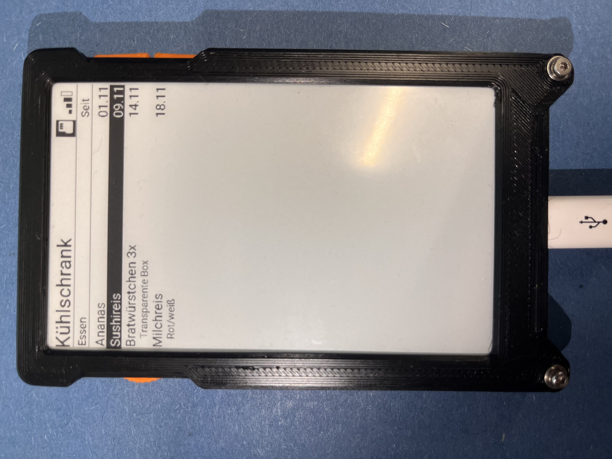
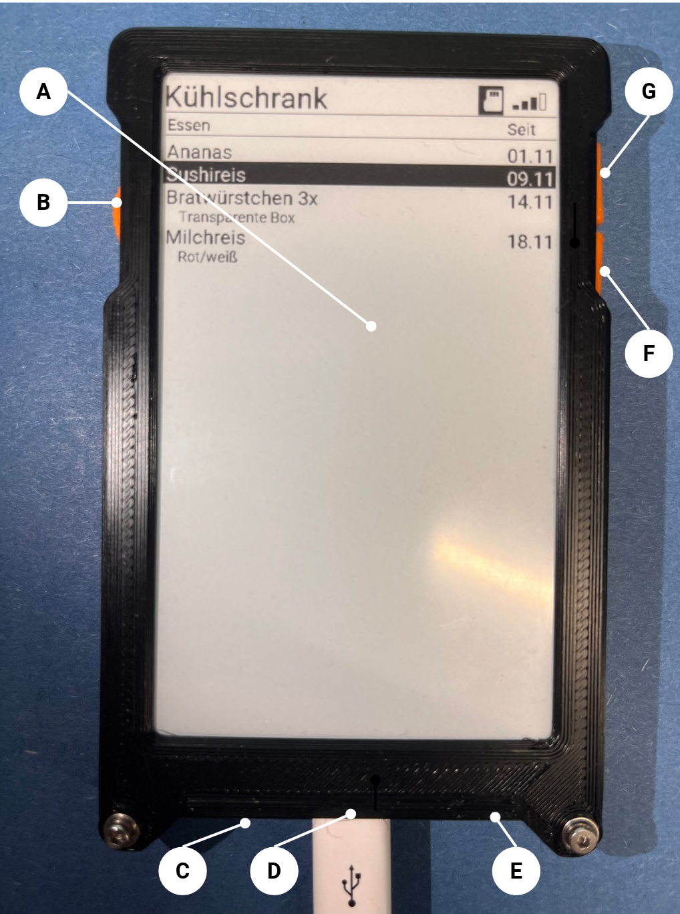

# embinotec todo display made for esphome

[](https://github.com/embinotec/embinotec-esphome-tododisplay/actions/workflows/ci.yml)
[](https://esphome.io/guides/made_for_esphome/)
[](https://esphome.io/changelog/)
[](LICENSE)


Eink Display zur Anzeige von ToDo-Listen aus HomeAssistant.


## Hardware

**Hardware could be purchased at [embinotec.de](https://www.embinotec.de/produktseite/todo-display).**  
<!--  -->

### Overview



- [A] Display
- [B] Jog dial | up, down, push
- [C] Microphone / Status LED
- [D] USB-C connector
- [E] SD-Card slot
- [F] User button
- [G] Power button

## Install 

###esphome device

Besides the preconfigure device setup in section `Fallback wifi` you have two possibilities to setup your device in your own esphome instance.

1. Copy the tododisplay.yaml into your ´esphome/config/´ folder. OR
2. Setup a new device in your esphome builder and import the tododisplay.yaml as configuration. OR
3. Add a new plain ESP32s3 generic device in esphome build and add `dashboard_import: https://github.com/embinotec/embinotec-esphome-tododisplay/blob/master/esphome/tododisplay.yaml`

### Fallback wifi

Display will be deliverted preconfigured. Scan your wifi area for a device called todo_display. Connect to the wifi with password `embinotec`. Set your wifi credentials in the captive portal.

### Setting up the template in HomeAssistant

- Add folder `templates` in homeAssistant/config 
``` bash 
  mkdir templates
```
- Add the following line to your `configuration.yaml` to include all valid templates
  ``` yaml
  template: !include_dir_merge_list templates/
  ```
- Copy the {project}\HomeAssistant\template_todo.yaml into templates folder
- Do a full restart your HomeAssistant instance.

## Usage

The usual flow:  
1. Place the box in fridge.
2. Enter item and description in HomeAssistant todo list.
3. When box is removed from fridge, use jog dial [B] to navigate to item index of the box.
4. Press and hold jog dial [B] for minimum 3 seconds.
5. Popup screen confirms the remove of the index in list.